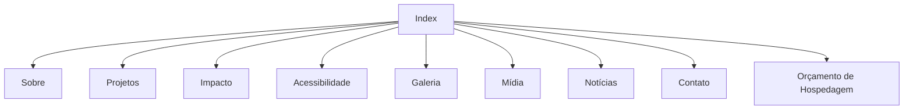

# Escopo do Projeto – EducaVerde

- **Disciplina:** Front-End para Web – A1 (2ª entrega)
- **Professor:** Prof. Paulo Fratta
- **Instituição:** UNICID – Curso Superior de Informática
- **Data:** setembro de 2026 (revisado em novembro de 2026 para a entrega final)
- **Projeto:** EducaVerde – Educação que transforma pessoas e o planeta

**Integrantes:** Abner Barbosa Machado, Kauã Freitas Passos Perroni, Luis Cauan Sena Rodrigues, Denner Souza Silva.

## 1. Contexto e justificativa

A educação é uma das principais ferramentas para promover mudanças sociais e ambientais. Por meio do conhecimento, é possível incentivar práticas sustentáveis, reduzir desigualdades e ampliar o acesso à informação para diferentes públicos, incluindo pessoas com deficiência.

O projeto EducaVerde divulga conteúdos educativos sobre sustentabilidade, inclusão social e cidadania em uma plataforma acessível e informativa. A proposta mostra como a educação está ligada ao desenvolvimento sustentável: incentiva a conscientização ambiental, promove a inclusão de pessoas com deficiência e contribui para a formação de cidadãos mais responsáveis e participativos.

**ODS relacionados:** ODS 4 (Educação de qualidade), ODS 10 (Redução das desigualdades), ODS 11 (Cidades e comunidades sustentáveis) e ODS 12 (Consumo e produção responsáveis).

## 2. Objetivos

**Objetivo geral:** desenvolver e publicar um site educativo em HTML5, CSS3 e JavaScript que conscientize os usuários sobre a educação como instrumento de transformação social e desenvolvimento sustentável.

**Objetivos específicos (mensuráveis):**

| Objetivo | Como medir |
|---|---|
| Divulgar projetos educacionais sustentáveis | Página Projetos com pelo menos 6 iniciativas |
| Incentivar práticas ambientais em escolas e comunidades | Notícias, dicas do EcoBot e área "Como apoiar" |
| Promover a inclusão de pessoas com deficiência | Alto contraste, navegação por teclado, alt em todas as imagens, transcrição de mídia |
| Apresentar dados sobre o impacto da educação | Página Impacto com indicadores, gráficos e tabela |
| Disponibilizar multimídia e canal de contato validado | Vídeo, áudio e mapa; formulário validado com JavaScript |

## 3. Público-alvo

Estudantes do ensino fundamental, médio e superior; professores e educadores; famílias interessadas em educação sustentável; organizações sociais; e **pessoas com deficiência, consideradas público prioritário**. Faixa etária: a partir de 12 anos.

## 4. Escopo funcional

O site possui **dez páginas interligadas** pelo menu principal, presente em todas elas.

| Página | Função |
|---|---|
| `index.html` | Apresentação do projeto e menu principal |
| `sobre.html` | História, missão, visão e valores |
| `projetos.html` | Projetos educativos e sustentáveis |
| `impacto.html` | Dados, gráficos e tabelas |
| `acessibilidade.html` | Recursos de inclusão para PCD |
| `galeria.html` | Imagens com legendas |
| `midia.html` | Vídeo, áudio e iframe (mapa) |
| `noticias.html` | Notícias com filtro por categoria |
| `contato.html` | Formulário validado, equipe e área de doações/apoio |
| `orcamento_hospedagem.html` | Comparativo de hospedagem, domínio e justificativa do deploy |

**Funcionalidades principais**

- Menu de navegação em todas as páginas, com versão para celular.
- Formulário de contato/voluntariado com validação HTML5 + JavaScript e rascunho salvo no localStorage.
- Área de doações e apoio (voluntariado, doação de materiais e parcerias).
- Galeria de imagens, vídeo, áudio e mapa incorporado.
- Notícias com filtro e "Ler mais".
- Botão de alto contraste com preferência salva.
- EcoBot: assistente de perguntas frequentes (diferencial).

## 5. Escopo não funcional

**Acessibilidade:** textos alternativos (alt) em todas as imagens; contraste mínimo AA e modo alto contraste; navegação por teclado com foco visível e link "Pular para o conteúdo"; HTML semântico e `lang="pt-BR"`; atributos ARIA quando necessários (`aria-expanded`, `aria-pressed`, `aria-live`, `aria-invalid`).

**Sustentabilidade:** conteúdo educativo sobre práticas sustentáveis; imagens com carregamento sob demanda (`loading="lazy"`); hospedagem estática no GitHub Pages, de menor consumo de recursos.

**Responsividade:** layout adaptado para celular, tablet e computador com CSS Grid e Flexbox.

**Desempenho:** código organizado, CSS e JavaScript externos, imagens comprimidas.

**SEO básico:** título único por página, meta descrição e hierarquia correta de títulos (h1, h2, h3).

## 6. Mapa do site

Todas as páginas também se ligam entre si pelo menu principal e pelo rodapé.

## 7. Conteúdo e identidade visual

- **Nome:** EducaVerde
- **Slogan:** Educação que transforma pessoas e o planeta.
- **Paleta:** verde `#2E7D32` (sustentabilidade), azul `#1565C0` (confiança, usado no foco), branco (leveza), cinza `#555555` (textos).
- **Tipografia:** Poppins, com Arial como fonte alternativa.
- **Tom de voz:** linguagem clara, educativa e acolhedora.
- **Imagens:** bancos gratuitos (Unsplash), com indicação da fonte.

## 8. Tecnologias e ferramentas

HTML5, CSS3, JavaScript, Visual Studio Code, Git e GitHub (versionamento, branches e pull requests), GitHub Pages (deploy), W3C Validator, Lighthouse (Chrome DevTools) e Trello (organização).

## 9. Cronograma e divisão de tarefas

| Etapa | Responsável |
|---|---|
| Estrutura HTML | Kauã e Abner |
| Desenvolvimento CSS | Luis Cauan e Denner |
| Produção do conteúdo | Kauã e Victor |
| JavaScript | Toda a equipe |
| Deploy no Vercel | Abner e Kauã |
| Documentação (/docs) | Toda a equipe |
| Testes e validação | Toda a equipe |

## 10. Riscos e restrições

**Riscos:** prazo reduzido; dificuldade na integração das páginas; falta de imagens adequadas; ajustes de acessibilidade; site fora do ar no dia da apresentação (plano B: vídeo e prints da demonstração).

**Restrições:** desenvolvimento em HTML5, CSS3 e JavaScript puro; cumprimento dos requisitos obrigatórios da disciplina.

## 11. Critérios de aceitação

O projeto será considerado concluído quando apresentar:

- 10 páginas HTML interligadas e funcionando online, sem links quebrados.
- Site publicado com HTTPS.
- Zero erros no W3C Validator.
- Formulário validado com JavaScript e dados mantidos com localStorage.
- Recursos de acessibilidade implementados e navegação completa por teclado.
- Conteúdo relacionado a educação, sustentabilidade e impacto social.
- Repositório com commits de todos os integrantes e pelo menos um pull request.
- Documentação atualizada na pasta `/docs`.
